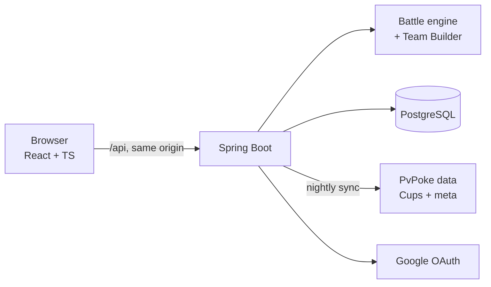

# DexPresso

**A Pokémon GO PvP team builder that works from the Pokémon you actually own.**

Pick a league or Cup, and DexPresso picks your best team of three from your collection and tells you how often it wins against the current meta, with a confidence range like *"wins 64%, 60–68%"*.

🔗 **Live at [dexpresso.app](https://dexpresso.app)**

<!-- Add a short GIF of the Team Builder here:  -->

---

## Features

- **Team Builder.** Simulates real 3v3 battles (switching, shared shields, energy carried between Pokémon) between your Pokémon and the meta. It ranks teams by win probability and recommends a lead.
- **Live Cups.** Cup rules and meta groups sync from PvPoke every night, so the Team Builder covers the current Cups as well as Great, Ultra and Master League.
- **IV rankings.** Ranks all 4,096 IV spreads of any species for each league's CP cap, so you can see how good a catch is for PvP.
- **Collection.** Sign in with Google to save your Pokémon, or use guest mode and keep them in your browser. Add Pokémon one at a time with quick add, or tick off species on the checklist.
- **CSV import.** Bring in a whole box from **Poké Genie** or **Calcy IV**. A preview step lets you pick moves before saving, and duplicates are skipped.
- **Power-up planning.** Breakpoints, a side-by-side comparison of two copies of a species, and a Stardust budget.

## How the Team Builder works

A single 3v3 battle takes about 8–25 ms, because the opponent AI simulates several 1v1s for every decision. Simulating every possible team against every opposing team would take around **2.6 hours per request**. To avoid that, the search narrows the field in stages and saves the expensive simulation for the end:

1. **Screen.** Every eligible Pokémon fights a 1v1 against each meta Pokémon. The best copy of each species is kept (GBL bans duplicates), and the top 10 go on after being rated at 0, 1 and 2 shields.
2. **Shortlist.** All 120 teams of those 10 are scored by coverage of the meta, and the top 5 are kept.
3. **Pick a lead.** Each shortlisted team plays every lead order against the same 100 sampled opposing teams. Using the same opponents for every team means the differences between teams aren't sampling noise.
4. **Estimate.** The best 3 teams are played against 400 *fresh* opposing teams, and the result is reported with a Wilson 95% interval (about ±5 points). Fresh samples avoid the winner's curse of reporting the best of several noisy estimates.

That comes to about **2,700 3v3 battles per request, or 7–10 seconds for a 3,000-Pokémon collection on 8 cores**. Sampling uses a fixed seed, so the same collection always gets the same answer.

The full reasoning is in [ADR 0005](docs/adr/0005-team-builder-win-odds-by-sampling.md).

## A battle engine checked against PvPoke

PvPoke's published matchup data can't account for your real IVs and movesets, so DexPresso has its own battle engine in Java ([ADR 0002](docs/adr/0002-own-battle-simulator.md)). To keep the engine trustworthy, PvPoke's own simulator runs in Node as a **test oracle** ([`tools/pvpoke-oracle`](tools/pvpoke-oracle)). A fixture of **3,000 seeded random matchups** is replayed in the test suite, and every result field has to match PvPoke exactly. The engine covers damage, type effectiveness, buffs and debuffs, shields, CMP ties, and PvPoke's TrainingAI for 3v3 switching.

## Tech stack

| | |
|---|---|
| **Backend** | Java 21, Spring Boot, Spring Security (Google OAuth2, CSRF), Spring Data JPA, Flyway |
| **Database** | PostgreSQL 17 |
| **Frontend** | React 19, TypeScript, Vite, Tailwind CSS, React Router |
| **Testing** | JUnit (300+ tests, including Postgres integration tests), Vitest, PvPoke oracle in Node |
| **Deploy** | One Docker image (React served by Spring from the same origin), Docker Compose, Caddy for HTTPS |
| **Data** | [PvPoke](https://github.com/pvpoke/pvpoke) gamemaster (MIT), meta groups and Cups, synced nightly |



## Running locally

You'll need **Java 21**, **Node 22**, and **Docker**.

```sh
# 1. Database
cd pokemon-optimizer-backend
cp .env.example .env        # set DB_USER, DB_PASSWORD, GOOGLE_CLIENT_ID, GOOGLE_CLIENT_SECRET
docker compose up -d        # Postgres 17 on :5432

# 2. API (Flyway creates the schema on startup)
./mvnw spring-boot:run      # http://localhost:8081

# 3. Frontend (in another terminal)
cd pokemon-optimizer-frontend
npm install
npm run dev                 # http://localhost:5173, proxies /api to :8081
```

Google login needs an OAuth client from the Google Cloud console with `http://localhost:8081/login/oauth2/code/google` as a redirect URI. Guest mode works without it.

### Tests

```sh
cd pokemon-optimizer-backend && ./mvnw test   # needs the Postgres container running
cd pokemon-optimizer-frontend && npm test
```

To regenerate the PvPoke matchup fixture after a gamemaster update, see [`tools/pvpoke-oracle/README.md`](tools/pvpoke-oracle/README.md).

### Production image

```sh
docker build -t dexpresso .
```

Deployment, environment variables and backups are covered in [`docs/DEPLOY.md`](docs/DEPLOY.md) and [`deploy/`](deploy).

## Project layout

```
pokemon-optimizer-backend/    Spring Boot API
  battle/                     battle engine: damage, type chart, buffs, shields, 3v3 + TrainingAI
  teambuilder/                staged search and win-odds estimation
  cups/                       nightly PvPoke Cup and meta sync
  calculator/                 CP and IV-spread ranking
  importer/                   Poké Genie and Calcy IV CSV parsing
  gamemaster/                 species, moves and learnsets loaded from PvPoke's gamemaster
pokemon-optimizer-frontend/   React + TypeScript app
tools/pvpoke-oracle/          PvPoke's simulator in Node, used as a test oracle
docs/adr/                     architecture decision records
deploy/                       production Compose file, Caddy config, backup script
GLOSSARY.md                   domain language (Species, Form, IV Spread, Cup, ...)
```

## Design decisions

The decisions behind the design are written down as ADRs:

1. [Team Builder targets standard 3v3 rather than Pick-6-Show-3](docs/adr/0001-team-builder-targets-3v3.md)
2. [Build our own battle simulator](docs/adr/0002-own-battle-simulator.md)
3. [Eligibility belongs to Cups, not Species](docs/adr/0003-eligibility-belongs-to-cups.md)
4. [PvPoke's gamemaster as the data source](docs/adr/0004-pvpoke-gamemaster-as-data-source.md)
5. [Rank teams by sampled 3v3 win odds](docs/adr/0005-team-builder-win-odds-by-sampling.md)

## Credits

Game data and the reference battle simulator come from [PvPoke](https://github.com/pvpoke/pvpoke) (MIT License). Pokémon artwork is loaded from [PokeAPI](https://github.com/PokeAPI/sprites).

DexPresso is an unofficial fan project and is not affiliated with Niantic, Nintendo, Game Freak or The Pokémon Company. Pokémon and Pokémon GO are trademarks of their respective owners.
